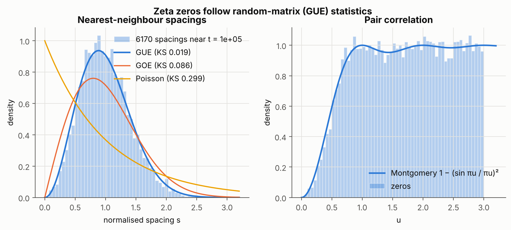
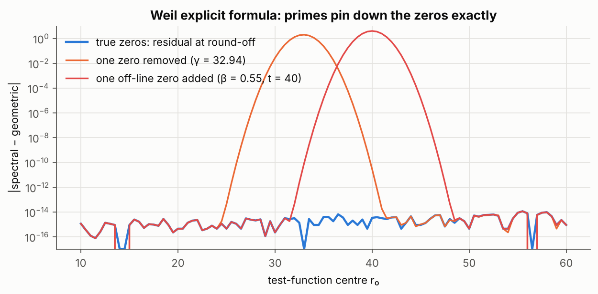

# riemann-test-py

Numerical lab for exploring the Riemann Hypothesis: zeta zeros, prime counting, Robin/Mertens/Li criteria, explicit formula, and GUE random-matrix statistics, with tests and plots. The Python package is `riemann_lab`.

Numerical experiments around the Riemann Hypothesis (RH), built alongside a
reading of A. M. Masullo's manuscript *The Music of the Primes* (2026 draft),
which claims a proof of GRH through a trace formula.

**Nothing here proves RH.** Each module tests a known equivalent or consequence
of RH numerically, so an idea can be checked against data before anyone tries
to prove it. Floating-point checks are evidence, not certificates.

## Install and run

```bash
pip install -e .[test]      # numpy, scipy, mpmath, matplotlib (+ pytest)
pytest -q                   # 25 tests, ~15 s
python -m riemann_lab report --quick      # every check, ~10 s
python -m riemann_lab report              # bigger ranges, ~1 min
python -m riemann_lab verify 100000 102000  # Turing-style check of one window
python -m riemann_lab plots --out docs/plots
```

## Modules

| Module | What it checks | Key functions |
| --- | --- | --- |
| `zeta` | Riemann–Siegel θ and Z(t) (vectorised numpy + mpmath reference), Gram points, N(T) = θ(T)/π + 1 + S(T) by the argument principle | `Z`, `Z_mp`, `gram_point`, `S`, `N_exact` |
| `zeros` | Locates zeros as sign changes of Z and certifies a window: if #sign changes = N(T2) − N(T1), every zero there is on the line (Turing's method) | `find_zeros`, `verify_window`, `gram_law_stats` |
| `primes` | π(x), Li(x), Riemann R(x), Riemann's explicit formula for π(x) and von Mangoldt's for ψ(x), Schoenfeld's RH bound | `pi_explicit`, `psi_explicit`, `check_schoenfeld` |
| `criteria` | Robin (brute force and at colossally abundant numbers up to 10^96000), Lagarias, Mertens, Keiper–Li coefficients λ_n | `robin_bruteforce`, `robin_at_ca`, `lagarias_bruteforce`, `mertens_summary`, `li_coefficients` |
| `explicit_formula` | Guinand–Weil explicit formula with Gaussian test functions; residual ~1e-16 with true zeros; injecting an off-line zero or dropping one breaks it | `check`, `scan` |
| `rmt` | Unfolded spacings vs GUE / GOE / Poisson (KS distance), Montgomery pair correlation | `spacings`, `ks_distances`, `pair_correlation` |
| `toy_trace` | Masullo's Example 1.8.1.1: trace of convolution on R>0/γ^Z computed spectrally, by Poisson summation and as a literal matrix trace | `demo`, `trace_spectral`, `trace_geometric`, `trace_matrix` |
| `plots` | The figures below | `make_all` |

## Results of the full run

Raw output is in [`results/`](results/): `pytest.txt`, `report.txt`, `verify_windows.txt`.

* Tests: 25 of 25 pass.
* Zeros: all 4,491 zeros with 100 < t ≤ 5000, all 4,626 with 10^5 < t ≤ 1.03·10^5 and all 3,812 with 10^6 < t ≤ 1.002·10^6 lie on the critical line (sign changes of Z equal N(T2) − N(T1)).
* Gram's law holds for 959 of the first 1,001 Gram intervals.
* Schoenfeld's RH bound |π(x) − li(x)| < √x log x / 8π holds up to 10^6 (tightest at x = 2657, ratio 0.964).
* Robin's inequality holds for 5040 < n ≤ 10^6 (max ratio 1.755814 at n = 10080) and at 19,992 colossally abundant numbers up to 10^96728 (max ratio 1.7808203 vs e^γ = 1.7810724).
* Lagarias's inequality holds for n ≤ 10^6.
* Mertens: |M(x)|/√x stays below 1 up to 10^6 (max 0.894 at x = 5).
* Keiper–Li: λ_1 … λ_20 all positive, λ_1 = 0.023095708966.
* Weil explicit formula: spectral and geometric sides agree to 4.4e-16.
* Masullo's toy trace formula: spectral, Poisson and matrix traces agree to 1e-15.
* Spacings near t = 10^5: KS distance 0.019 to GUE, 0.087 to GOE, 0.299 to Poisson.

## Figures

| | |
| --- | --- |
|  |  |
|  |  |
|  |  |
|  |  |

## Extending

* Higher windows: `zeros.verify_window(1e6, 1.001e6)` works; numpy Z is O(√t) per point.
* New test functions for the explicit formula: supply `h`/`g` pairs in `explicit_formula`.
* Masullo's restricted-strip trace formula: for F = Q it says the geometric side equals
  the sum over zeros with |Re ρ − 1/2| ≤ α only. `explicit_formula.check(..., extra_zeros=...)`
  shows what an off-line zero would do to that identity.
* Not implemented: de Bruijn–Newman heat flow H_t, Dirichlet/Hecke L-functions, interval arithmetic.
