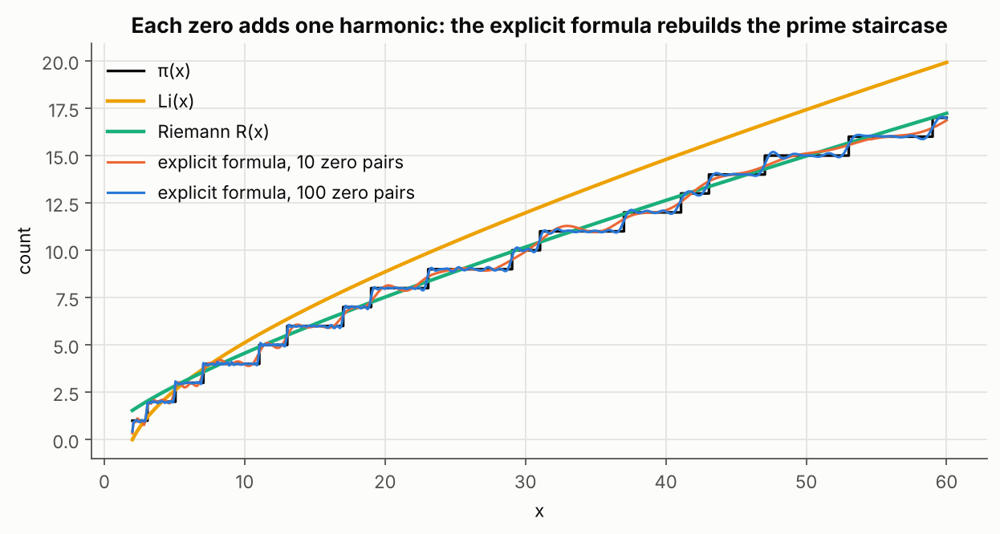
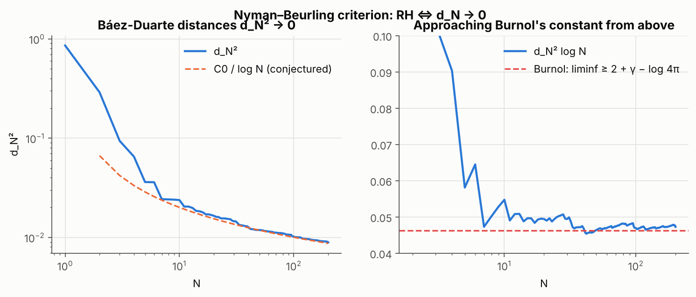
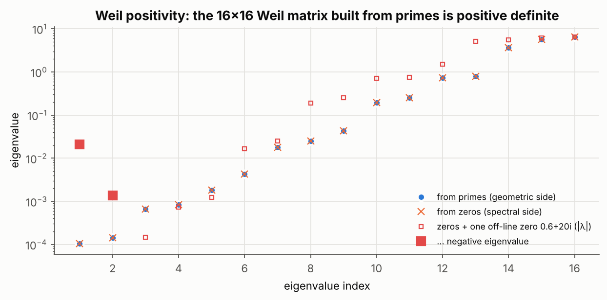

# riemann-test-py

A numerical and formal lab around the Riemann Hypothesis and its generalisation to Dirichlet L-functions (GRH),
built alongside a reading of A. M. Masullo's draft *The Music of the Primes* (2026), which claims a proof of GRH
through a trace formula. The Python package is `riemann_lab`; the Lean 4 project is in [`lean/`](lean/).

**Nothing here proves RH or GRH.** Every statement below carries one of three labels: **proved** (machine-checked
in Lean, or a classical theorem), **conditional** (true under stated hypotheses, such as GRH), or **numerical**
(floating-point evidence, not a certificate).

Paper: [docs/paper/combined_norm.pdf](docs/paper/combined_norm.pdf) (arXiv style, with the Lean proof).
Detailed results of every run: [docs/TESTS.md](docs/TESTS.md).

## Main results

### 1. The combined norm identity, formally verified (and half of the GRH equivalence)

For a Dirichlet character χ, let M̃_χ(x) = Σ_n μ(n)χ(n)/n · (e^{−x/n²} − 1), which is the
Hardy–Littlewood–Ramanujan function M_χ minus its limit 1/L(1, χ) at 0. Lean 4 + Mathlib checks, with no
`sorry`, no named hypothesis and no axiom beyond Lean's standard three:

    ∫₀^∞ x^{s−1} M̃_χ(x) dx = Γ(s) / L(1 − 2s, χ)        for −1 < Re s < 0          (mellin_Mt)

    ∫₀^∞ |M̃_χ(x)|² x^{1−2α} dx = (1/2π) ∫_ℝ |Γ(1−α+it) / L(2α−1−2it, χ)|² dt      for 1 < α < 2
                                                              (combined_norm_identity_unconditional)

The second line used to rest on a named hypothesis (Mellin–Plancherel). That is now proved too: Plancherel in
integral form for L¹ ∩ L² functions (`plancherel`, derived from Mathlib's L² Fourier isometry and tempered
distributions), its Mellin form on a vertical line (`mellin_plancherel`), and the two integrability conditions for
M̃_χ (`MtBounds.lean`).

Lean also checks the GRH-sensitive half as an equivalence (Hardy–Littlewood 1918 for ζ, Garg–Maji 2022 for χ):

    for χ primitive, χ ≠ 1:
    GRH(χ)  ⟺  ∫₀^∞ |M_χ(x)|² x^{1−2α} dx < ∞ for every α ∈ (3/4, 1)          (grh_iff_finite_norm)

⇐ (`grh_of_finiteNorms'`): K(s) = s(∫₀¹ x^{s−1}M̃_χ + ∫₁^∞ x^{s−1}M_χ) + 1/L(1, χ) continues holomorphically to
−1 < Re s < 1/4, K(s) L(1 − 2s, χ) = Γ(s + 1) there by the identity theorem, and the functional equation plus
L(s, χ⁻¹) = conj L(conj s, χ) handle the zeros left of 1/2.

⇒ (`finiteNorms_of_GRH`): Abel summation gives |L(s, χ)| ≤ N|s|/Re s on Re s > 0; under GRH, a holomorphic
logarithm of L on discs in Re w > 1/2 and Borel–Carathéodory turn that into |1/L(w, χ)| ≤ C(|Im w| + 8)^K on
1/2 + δ ≤ Re w ≤ 3; with |Γ(s)| |Im s|^k ≤ Γ(Re s + k) this makes the Mellin transform of M̃_χ − (e^{−x} − 1)/L(1, χ)
decay like (1 + Im² s)⁻¹ on −1/2 ≤ Re s ≤ 1 − α. Mellin inversion, a rectangle contour shift and Plancherel then give
the finite norm.

This is an equivalence, not a proof of GRH: neither side is proved, and nothing here says the norms are finite.

This is the unconditional half of the combined Ramanujan + Majorana + Masullo equation: the left side is the
Ramanujan/Laplace side, which equals Majorana's discrete-series norm ‖F_χ‖²_{D⁺_α} (checked numerically), and the
right side is Masullo's line seminorm.

| Status | What |
| --- | --- |
| **proved** (Lean) | shifted Euler integral ∫x^{s−1}(e^{−x} − 1) = Γ(s); the Tonelli bound and Fubini interchange; the Mellin identity; Plancherel for L¹ ∩ L²; Mellin–Plancherel; the norm identity on 1 < α < 2; Σ μ(n)χ(n)/n = 1/L(1, χ) and the convergence of the series for M_χ; GRH(χ) ⟺ finite norms for every α ∈ (3/4, 1) |
| **conditional** (Lean, as an equivalence) | GRH(χ) itself and the finiteness of the norms on (3/4, 1): each is equivalent to the other, neither is proved |
| **proved from a named hypothesis** (Lean) | the blow-up (α − 3/4)‖M_χ‖² → B_χ = (1/8)Σ_ρ\|Γ((1−ρ)/2)/L′(ρ)\|² under GRH, Σ_ρ\|Γ/L′\| < ∞ and `ZeroExpansion` (`blowup_limit_of_expansion`). `ZeroExpansion` is the explicit formula M_χ(x) = Σ_ρ c_ρ x^{−(1−ρ)/2} + r(x) for x > 1, with c_ρ = −Γ((1−ρ)/2)/(2L′(ρ)) and ∫₁^∞\|r\|² x^{−1/2} dx < ∞. It is assumed, not proved |
| **open, stated with `sorry`** (Lean) | the same blow-up without `ZeroExpansion` (`blowup_limit`): proving the zero expansion needs a contour shift past all the zeros |
| **definition note** | M_χ is defined in Lean as M̃_χ + 1/L(1, χ). That is now a theorem, not a convention: Lean proves Σ_{n≤X} μ(n)χ(n)/n → 1/L(1, χ) for χ ≠ 1 (`tendsto_sum_mu_div`, via the prime number theorem in progressions and Landau's Σ μχ = o(X)), and that the partial sums of Σ μ(n)χ(n)/n · e^{−x/n²} converge to the Lean M_χ(x) for every x > 0 (`tendsto_M_partial`). So nothing is assumed in `grh_iff_finite_norm`. A Lean `tsum` is still not usable here, because the series converges only conditionally and such a `tsum` is 0 |
| **numerical** | the four-way equality of the norm, the blow-up constant, the off-line-zero controls ([docs/TESTS.md](docs/TESTS.md)) |

Run it: `python -m riemann_lab lean` (needs [elan](https://lean-lang.org); the first build downloads the Mathlib cache).
The [Lean workflow](.github/workflows/lean.yml) runs the build, the axiom audit and the numerical cross-checks on
every pull request that touches `lean/`. The audit fails if a theorem listed as proved picks up `sorryAx`, or if a
theorem listed as open stops needing it.

### 2. Tests

| Suite | Command | Result |
| --- | --- | --- |
| Unit tests | `pytest -q` | 115 tests pass (the Lean audit test skips when lake is absent) |
| Lean build + audit + numerics | `python -m riemann_lab lean` | PASS (30 proved, 1 open) |
| Original checks | `python -m riemann_lab report` | zeros on the line in 3 windows to t = 10^6, Robin, Lagarias, Mertens, Li, Weil, GUE |
| Extended criteria | `python -m riemann_lab extended` | 7/7 consistent |
| Ramanujan × Masullo | `python -m riemann_lab ramanujan` | 8/8 consistent |
| Majorana × Masullo | `python -m riemann_lab majorana` | 8/8 consistent |
| Hardy–Littlewood–Ramanujan | `python -m riemann_lab hlr` | 6/6 consistent |
| Combined norm | `python -m riemann_lab combined` | 5/5 consistent |

Raw output is in [`results/`](results/); what each check measures, and the convergence log of every run, is in
[docs/TESTS.md](docs/TESTS.md).

## Methodology

1. **Criteria before code.** Each run starts from a done-criteria file in [`docs/`](docs/) that fixes what
   "converged" means (agreement of two precisions, two truncations, two independent methods, or a closed form).
   When a criterion turns out to be wrong rather than the numbers, it is amended in that file with the reason.
2. **Independent methods.** Each quantity is computed at least two ways that share no code path: power series
   against Möbius sums against zero expansions; the x side of a norm against the Mellin side, which uses no zeros.
3. **Exact inputs.** Character values come from one table of exact roots of unity, and every cancellation-prone
   step runs at a working precision chosen for it, because x³-type amplification turns 10^−16 into 10^−1.
4. **Controls.** Every criterion is also run on a model with an injected off-line zero, to show it would fail.
   The visibility estimate (weight e^{−π|γ|/4}) records which zeros a check can see at all.
5. **Full run, fix, re-run until converged**, with each failure and its fix logged.
6. **Formal layer.** Statements that can be proved from Mathlib are proved in Lean; anything else is a named
   hypothesis or a `sorry`, and the axiom audit keeps the two lists honest.

## Prior art and what is new

**Prior art, up front.** The central statements of the fifth and sixth runs are known theorems:

| Year | Result | Reference |
| --- | --- | --- |
| 1918 | RH ⇔ Σ (−x)^k/(k! ζ(2k+1)) = Σ μ(n)/n e^{−x/n²} = O(x^{−1/4+ε}); the αβ = π identity (Ramanujan's lost-notebook claim, corrected), assuming simple zeros | G. H. Hardy, J. E. Littlewood, Acta Math. 41 (1918), 119–196, §2.5 |
| 2012 | Character analogues of the αβ identity for even and odd primitive χ (normalised with αβ = 1 and Gauss sums), assuming simple zeros | A. Dixit, Pacific J. Math. 255 (2012), 317–348, Thms 1.9–1.10 ([arXiv:1102.2680](https://arxiv.org/abs/1102.2680)) |
| 2022 | GRH for primitive χ ⇔ Σ χ(n)μ(n) n^{−k} e^{−x/n^ℓ} = O(x^{−k/ℓ+1/(2ℓ)+ε}) (k = 1, ℓ = 2 is our M_χ), plus a one-sided zero expansion | M. Garg, B. Maji ([arXiv:2208.07596](https://arxiv.org/abs/2208.07596)), Thms 2.1–2.2 |

**What is new here, and of what kind.** None of it is a new result about where the zeros are, and none of it
brings RH closer. Each item is labelled by kind: *reformulation* (an equivalent restatement), *corollary* (a
short consequence with a proof sketch, conditional where marked), *numerical extension* or *new test*.

1. **The combined norm identity**, beyond Hardy–Littlewood and Garg–Maji (*reformulation*). Their criterion is a
   sup bound on M_χ. Here it becomes membership in a Hilbert scale, with one norm computed four ways:

       ||F_χ||²_{D⁺_α} = ∫|M_χ(t)|² t^{1−2α} dt = ∫|M_χ(x)|² x^{2c} dx/x = (1/2π)∫|Γ(c+it)/L(1−2c−2it, χ)|² dt,   c = 1 − α,

   with F_χ(w) = Σ μ(n)χ(n) n/(1 − i n² w) the holomorphic (Majorana discrete-series) vector.
   *Statement:* GRH for χ ⇔ F_χ ∈ D⁺_α for every α ∈ (3/4, 1). The proof is the Hardy–Littlewood argument with
   Cauchy–Schwarz and Mellin–Plancherel. ⇒: M_χ = O(x^{−1/4+ε}) and M_χ → 1/L(1, χ) at 0 make every line norm
   finite. ⇐: finite norms on two lines c₁ < c₂ give absolute convergence of the Mellin integral on c₁ < Re s < c₂,
   so Γ(s)/L(1−2s, χ) has no poles in 0 < Re s < 1/4. The same identity for M_χ − 1/L(1, χ) on α ∈ (1, 2) is
   unconditional. *Example:* χ5_2 (even, mod 5) at α = 0.9 has ||F||² = 27.31576149, the same from the x side and
   from |Γ/L|² alone (no zeros), to 4·10^−16.
2. **The critical-line blow-up constant**, beyond Hardy–Littlewood and Garg–Maji (*corollary, conditional*).
   Assume GRH for χ, simple zeros, and that the zero expansion of M_χ converges absolutely. Then
       lim_{α→3/4⁺} (α − 3/4) ||F_χ||²_{D⁺_α} = B_χ = (1/8) Σ_ρ |Γ((1−ρ)/2)/L′(ρ, χ)|².
   *Sketch:* x^{1/4}M_χ(e^u) = f(u) + O(e^{−u/4}), with f(u) = Σ c_ρ e^{iγu/2} almost periodic and Σ|c_ρ| < ∞. Then
   (α − 3/4)∫|M|² x^{1−2α}dx = h∫e^{−2hu}|f(u)|²du + O(h) → (1/2)·mean|f|² = (1/2)Σ|c_ρ|² (Parseval for
   absolutely convergent almost periodic series; distinct ordinates follow from simplicity). It is a mean-square
   version of the amplitude bound, and the fastest-diverging line pins Re ρ: an off-line zero with real part β
   moves the divergence to α = (1+β)/2. We have not found this limit stated in the three papers above. It is
   elementary, so it may well be known elsewhere. *Example:* for ζ, B = 2.139767·10^−10, matched by the
   extrapolated norm to 1·10^−15 relative (`critical-blowup`).
3. **Reciprocity with αβ = π/q, written out in full**, beyond Dixit (*reformulation + new test*). Even χ:
   M_χ(α²) = ε̄ √(π/q)/α · (M_χ̄(β²) − 1/L(1, χ̄)) + Z_χ(α²) + √π/(2α L′(0, χ)). Odd χ:
   N_χ(α²) = ε̄ √(π/q)/α · N_χ̄(β²) + Z^odd_χ(α²), with N_χ(x) = √x Σ μχ(n)/n² e^{−x/n²}. Here ε is the root number.
   It is derived here independently, by a contour shift, with the constant 1/L(1, χ̄) and the trivial-zero term at
   s = 1/2 shown explicitly. We have not checked whether Dixit's normalisation absorbs them. The new part is the
   test: it holds to ≤ 3·10^−14 for ζ and all 32 primitive characters mod 3, 4, 5, 7, 8, 11, 13, at three α and two
   zero heights.
4. **Large-x evidence**, beyond all three (*numerical extension*). Möbius sums to N = 10^7, with exact character
   values and order-3 tails (rigorous Taylor remainder), match the zero expansion up to x = 10^11 for 33
   L-functions. The budget is 2.5·10^−10 x^{−1/4}, and the measured differences are ~10^−13. We did not find
   comparable computations in the three papers.
5. **What the criterion can see**, beyond all three (*elementary estimate + new test*). An off-line zero at height γ
   enters with weight |Γ((1−ρ)/2)| ≈ e^{−π|γ|/4}. At x ≤ 10^11 it is detectable only for γ ≲ 35 (measured, with
   injected zeros). Making it dominant at the RH-verified height 3·10^12 needs log10 x ≈ 4·10^12. Hence agreement at
   reachable x is not evidence about high zeros.
6. **Precision of the classical statements** (*corrections, not new theorems*). The Mellin identity holds
   unconditionally only for M_χ − 1/L(1, χ) on −1 < Re s < 0, by Fubini, not by RMT. Hardy's RMT hypothesis holds
   on each closed half-plane Re z ≥ −δ, δ < 1/4, under GRH, never uniformly on the open one.

## Install and run

```bash
pip install -e .[test,rigorous]   # numpy, scipy, mpmath, matplotlib (+ pytest, python-flint)
pytest -q                   # 114 tests, ~2 min (the Lean audit test skips without lake)
python -m riemann_lab report --quick      # original checks, ~10 s
python -m riemann_lab report              # bigger ranges, ~1 min
python -m riemann_lab extended --quick    # new criteria with convergence verdicts, ~1.5 min
python -m riemann_lab extended            # full run, ~11 min (results/extended_report.txt)
python -m riemann_lab ramanujan --quick   # Ramanujan x Masullo checks, ~6 min
python -m riemann_lab ramanujan           # full run, ~12 min on 4 cores (results/ramanujan_report.txt)
python -m riemann_lab majorana --quick    # Majorana x Masullo checks, ~5 min
python -m riemann_lab majorana           # full run, ~7 min on 4 cores (results/majorana_report.txt)
python -m riemann_lab hlr                # Hardy-Littlewood-Ramanujan investigation, ~28 min (results/hlr_report.txt)
python -m riemann_lab combined           # Ramanujan + Majorana + Masullo combined norm, ~60 min (results/combined_report.txt)
python -m riemann_lab lean             # Lean 4: lake build + axiom audit + numerics (needs elan)
python -m riemann_lab turing 1e6 1.0005e6 # Turing's method on one window
python -m riemann_lab verify 100000 102000  # Turing-style check of one window
python -m riemann_lab plots --out docs/plots
```

## Modules

| Module | What it checks | Key functions |
| --- | --- | --- |
| `zeta` | Riemann–Siegel θ and Z(t) (vectorised numpy + mpmath reference), Gram points, N(T) = θ(T)/π + 1 + S(T) by the argument principle | `Z`, `Z_mp`, `gram_point`, `S`, `N_exact` |
| `zeros` | Locates zeros as sign changes of Z and certifies a window: if #sign changes = N(T2) − N(T1), every zero there is on the line (Turing's method) | `find_zeros`, `verify_window`, `gram_law_stats` |
| `primes` | π(x), Li(x), Riemann R(x), Riemann's explicit formula for π(x) and von Mangoldt's for ψ(x), Schoenfeld's RH bound | `pi_explicit`, `psi_explicit`, `check_schoenfeld` |
| `criteria` | Robin (brute force and at colossally abundant numbers up to 10^96000), Lagarias, Mertens, Keiper–Li coefficients λ_n | `robin_bruteforce`, `robin_at_ca`, `lagarias_bruteforce`, `mertens_summary`, `li_coefficients` |
| `explicit_formula` | Guinand–Weil explicit formula with Gaussian test functions; residual ~1e-16 with true zeros; injecting an off-line zero or dropping one breaks it | `check`, `scan` |
| `rmt` | Unfolded spacings vs GUE / GOE / Poisson (KS distance), Montgomery pair correlation | `spacings`, `ks_distances`, `pair_correlation` |
| `toy_trace` | Masullo's Example 1.8.1.1: trace of convolution on R>0/γ^Z computed spectrally, by Poisson summation and as a literal matrix trace | `demo`, `trace_spectral`, `trace_geometric`, `trace_matrix` |
| `turing` | Turing's method: N(g_n) exactly from Trudgian's bound on ∫S(t)dt, no argument principle; sign changes accepted only above Gabcke's Riemann–Siegel error bound | `turing_verify`, `turing_anchor` |
| `dbn` | de Bruijn–Newman heat flow H_t via Gauss–Hermite averaging of ξ; backward collision times of close zero pairs (finite-window Λ estimates); argument-principle check that H_{t0} has no zeros with Im z ≥ y0 for Re z ≤ X | `H`, `window_estimate`, `exact_collision_time`, `rectangle_zero_free` |
| `nyman_beurling` | Báez-Duarte distances d_N (Vasyunin's Gram formula, mpmath Cholesky at two precisions) | `distances`, `summary` |
| `weil` | Weil positivity on families of Gaussian test functions: the Weil matrix built from primes must be positive semidefinite | `check_family`, `weil_matrix`, `scalar_scan` |
| `li_rigorous` | Keiper–Li λ_n to n = 10^4 in Arb ball arithmetic (python-flint), mpmath.iv fallback | `li_coefficients_rigorous`, `summary` |
| `riesz_redheffer` | Riesz function R(x) to 10^10 with a rigorous truncation bound, checked against its zero expansion; det(Redheffer) = M(n) | `riesz`, `riesz_from_zeros`, `redheffer_check` |
| `extended` | Runs the six new checks and gives each a convergence/consistency verdict | `run` |
| `hecke` | Dirichlet L-functions = Hecke L-functions over Q (Masullo's GL(1) case): primitive characters mod 3, 4, 5, 7, 8, 11, 13, Z_χ(t), zeros on the line, argument-principle zero count in the strip, Weil explicit formula for χ, partial Euler products on the 1-line, Nicolas' primorial criterion | `primitive_characters`, `line_zeros`, `winding_count`, `explicit_formula`, `euler_product_1line`, `nicolas_primorials` |
| `ramanujan` | Ramanujan's Master Theorem (Hardy's form) with Bernoulli-number coefficients of L(s, χ); Masullo's Hardy–Sobolev norms via RMT + Mellin–Plancherel; the Hardy–Littlewood–Ramanujan function Σμ(n)χ(n)/n e^{−x/n²} three ways (power series, Möbius sum, zero expansion); Ramanujan's αβ = π identity; Robin's constant at colossally abundant numbers; Ramanujan sums; τ(n) and zeros of L(Δ, s) | `rmt_check`, `hardy_sobolev_check`, `hl_series`, `MobiusTable`, `hl_zero_expansion`, `ramanujan_alpha_beta`, `tau_checks`, `DeltaL` |
| `majorana` | Majorana's infinite-component tower (Gel'fand–Naimark matrices, mass spectrum m/(s+½), tachyonic branch, spectral zeta); D⁺_α of SL(2,ℝ) carried by Cayley + Laplace + Mellin to Masullo's line norms; local RH for the basis (Meixner–Pollaczek); Ξ in that basis; Majorana stars of Jensen polynomials; class D/C BdG matrices and quadratic Dirichlet zeros (theta integral); Majorana's Thomas–Fermi series and its Mellin transform; Norton–Sakuma algebras in exact arithmetic, j coefficients, Rademacher, Weil | `tower_check`, `hardy_sobolev_chain`, `local_rh`, `xi_mp_coefficients`, `majorana_stars`, `bdg_samples`, `QuadraticL`, `tf_series`, `TFMajorana`, `norton_sakuma_check` |
| `majorana_checks` | Runs the eight Majorana × Masullo checks against criteria fixed before they were built ([docs/majorana_done_criteria.md](docs/majorana_done_criteria.md)) | `run` |
| `ramanujan_checks` | Runs the eight Ramanujan × Masullo checks against criteria fixed before they were built ([docs/ramanujan_done_criteria.md](docs/ramanujan_done_criteria.md)) | `run` |
| `hlr` | The Hardy–Littlewood–Ramanujan function M_χ(x) = Σμ(n)χ(n)/n e^{−x/n²} with exact character values: power series, Möbius sum with order-J tails (to x = 10^11 at N = 10^7), residue expansion, Mellin transform on −1 < Re s < 0, Hardy's hypothesis at its edge, the α β = π/q reciprocity for even and odd χ, amplitude, off-line-zero sensitivity | `Series`, `MobiusSum`, `ZeroExpansion`, `mellin_strip`, `reciprocity`, `amplitude_sup`, `log10_x_to_see` |
| `hlr_checks` | Runs the six HLR checks ([docs/hlr_done_criteria.md](docs/hlr_done_criteria.md)) | `run` |
| `combined` | One norm, four computations: Majorana's D⁺_α (holomorphic F_χ(w) = Σμχ(n) n/(1 − i n² w), Paley–Wiener), the Laplace side, Masullo's line seminorm on Re z = 1 − α, and RMT + Plancherel (|Γ/L|² on the line); blow-up at the critical line; an off-line-zero model | `line_norm_x`, `line_norm_mellin`, `Holo`, `hline_integral`, `laplace_weighted`, `B_from_zeros`, `moved_zero_L` |
| `combined_checks` | Runs the five combined checks ([docs/combined_done_criteria.md](docs/combined_done_criteria.md)) | `run` |
| `lean_bridge` | Launcher for the Lean 4 project in `lean/`: `lake build`, `#print axioms` audit (proved vs `sorry`), mpmath checks of the Lean statements | `build`, `audit`, `classify`, `numerics`, `run` |
| `plots` | The figures below | `make_all` |

## Figures

| | |
| --- | --- |
|  |  |
|  |  |
|  |  |
|  |  |
|  |  |
|  |  |
|  |  |

## Extending

* Higher windows: `zeros.verify_window(1e6, 1.001e6)` works; numpy Z is O(√t) per point.
* New test functions for the explicit formula: supply `h`/`g` pairs in `explicit_formula`.
* Masullo's restricted-strip trace formula: for F = Q it says the geometric side equals
  the sum over zeros with |Re ρ − 1/2| ≤ α only. `explicit_formula.check(..., extra_zeros=...)`
  shows what an off-line zero would do to that identity.
* Dirichlet L-functions are in `hecke` (Hecke characters of other number fields are not).
* Not implemented: the large-x (asymptotic) half of a de Bruijn–Newman upper bound;
  interval arithmetic outside `li_rigorous`.
