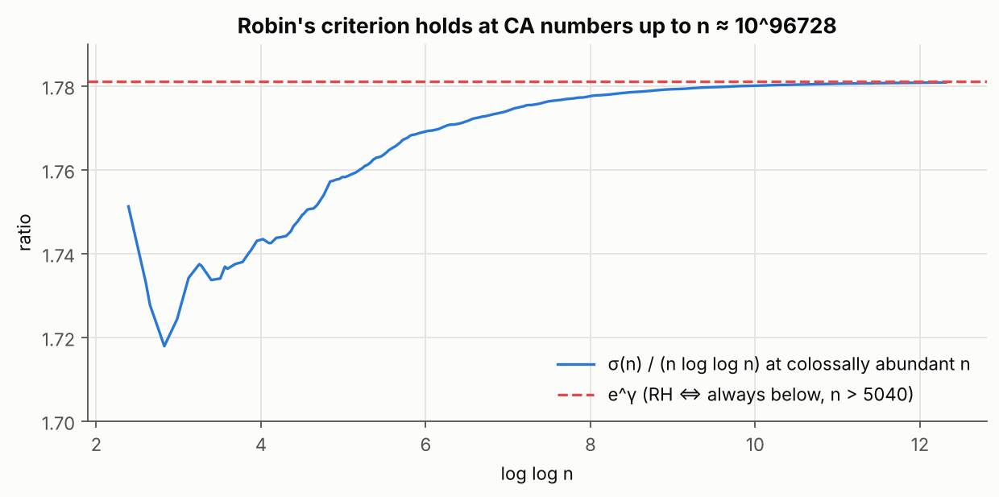
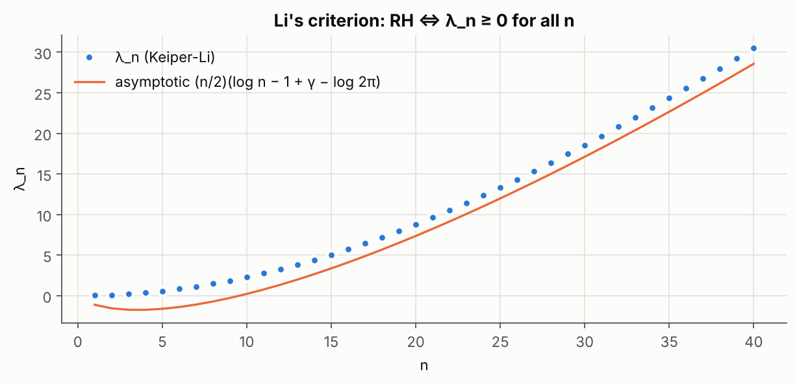
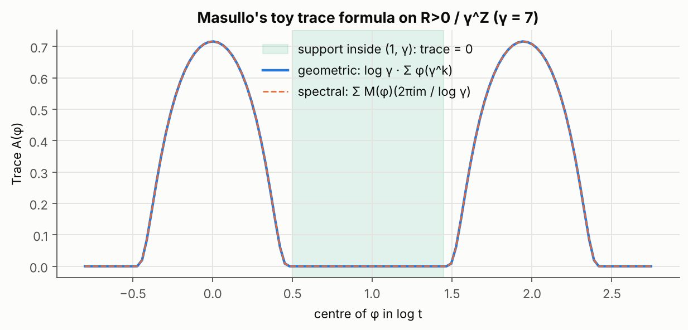
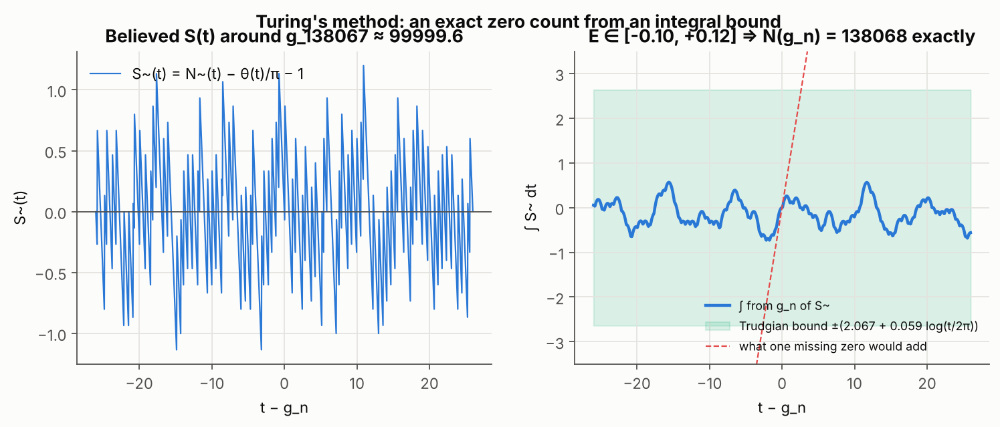
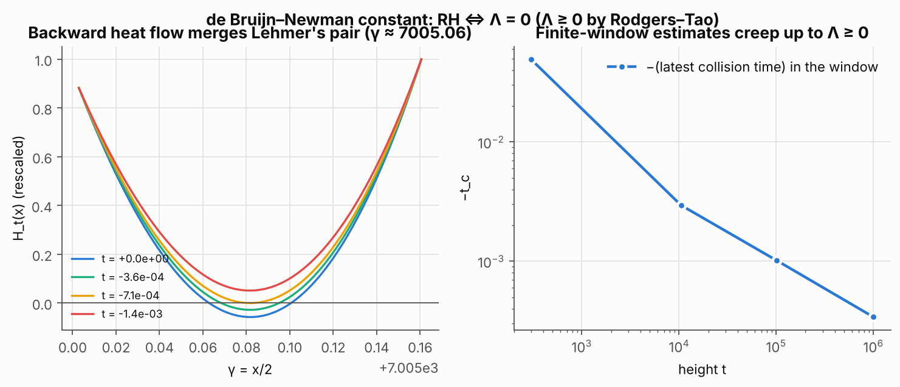

# riemann-test-py

Numerical lab for exploring the Riemann Hypothesis: zeta zeros, prime counting, Robin/Mertens/Li criteria, explicit formula, GUE random-matrix statistics, Turing's method, the de Bruijn–Newman heat flow, Nyman–Beurling distances, Weil positivity, certified Li coefficients, and the Riesz and Redheffer criteria, with tests and plots. The Python package is `riemann_lab`.

Numerical experiments around the Riemann Hypothesis (RH), built alongside a
reading of A. M. Masullo's manuscript *The Music of the Primes* (2026 draft),
which claims a proof of GRH through a trace formula.

**Nothing here proves RH.** Each module tests a known equivalent or consequence
of RH numerically, so an idea can be checked against data before anyone tries
to prove it. Floating-point checks are evidence, not certificates.

## Install and run

```bash
pip install -e .[test,rigorous]   # numpy, scipy, mpmath, matplotlib (+ pytest, python-flint)
pytest -q                   # 44 tests, ~20 s
python -m riemann_lab report --quick      # original checks, ~10 s
python -m riemann_lab report              # bigger ranges, ~1 min
python -m riemann_lab extended --quick    # new criteria with convergence verdicts, ~1.5 min
python -m riemann_lab extended            # full run, ~11 min (results/extended_report.txt)
python -m riemann_lab turing 1e6 1.0005e6 # Turing's method on one window
python -m riemann_lab verify 100000 102000  # Turing-style check of one window
python -m riemann_lab plots --out docs/plots
```

## Modules

| Module | What it checks | Key functions |
| --- | --- | --- |
| `zeta` | Riemann–Siegel θ and Z(t) (vectorised numpy + mpmath reference), Gram points, N(T) = θ(T)/π + 1 + S(T) by the argument principle | `Z`, `Z_mp`, `gram_point`, `S`, `N_exact` |
| `zeros` | Locates zeros as sign changes of Z and certifies a window: if #sign changes = N(T2) − N(T1), every zero there is on the line (Turing's method) | `find_zeros`, `verify_window`, `gram_law_stats` |
| `primes` | π(x), Li(x), Riemann R(x), Riemann's explicit formula for π(x) and von Mangoldt's for ψ(x), Schoenfeld's RH bound | `pi_explicit`, `psi_explicit`, `check_schoenfeld` |
| `criteria` | Robin (brute force and at colossally abundant numbers up to 10^96000), Lagarias, Mertens, Keiper–Li coefficients λ_n | `robin_bruteforce`, `robin_at_ca`, `lagarias_bruteforce`, `mertens_summary`, `li_coefficients` |
| `explicit_formula` | Guinand–Weil explicit formula with Gaussian test functions; residual ~1e-16 with true zeros; injecting an off-line zero or dropping one breaks it | `check`, `scan` |
| `rmt` | Unfolded spacings vs GUE / GOE / Poisson (KS distance), Montgomery pair correlation | `spacings`, `ks_distances`, `pair_correlation` |
| `toy_trace` | Masullo's Example 1.8.1.1: trace of convolution on R>0/γ^Z computed spectrally, by Poisson summation and as a literal matrix trace | `demo`, `trace_spectral`, `trace_geometric`, `trace_matrix` |
| `turing` | Turing's method: N(g_n) exactly from Trudgian's bound on ∫S(t)dt, no argument principle; sign changes accepted only above Gabcke's Riemann–Siegel error bound | `turing_verify`, `turing_anchor` |
| `dbn` | de Bruijn–Newman heat flow H_t via Gauss–Hermite averaging of ξ; backward collision times of close zero pairs (finite-window Λ estimates); argument-principle check that H_{t0} has no zeros with Im z ≥ y0 for Re z ≤ X | `H`, `window_estimate`, `exact_collision_time`, `rectangle_zero_free` |
| `nyman_beurling` | Báez-Duarte distances d_N (Vasyunin's Gram formula, mpmath Cholesky at two precisions) | `distances`, `summary` |
| `weil` | Weil positivity on families of Gaussian test functions: the Weil matrix built from primes must be positive semidefinite | `check_family`, `weil_matrix`, `scalar_scan` |
| `li_rigorous` | Keiper–Li λ_n to n = 10^4 in Arb ball arithmetic (python-flint), mpmath.iv fallback | `li_coefficients_rigorous`, `summary` |
| `riesz_redheffer` | Riesz function R(x) to 10^10 with a rigorous truncation bound, checked against its zero expansion; det(Redheffer) = M(n) | `riesz`, `riesz_from_zeros`, `redheffer_check` |
| `extended` | Runs the six new checks and gives each a convergence/consistency verdict | `run` |
| `plots` | The figures below | `make_all` |

## Results of the full run

Raw output is in [`results/`](results/): `pytest.txt`, `report.txt`, `verify_windows.txt`, `extended_report.txt`.

* Tests: 44 of 44 pass (25 original + 19 for the new criteria).
* Zeros: all 4,491 zeros with 100 < t ≤ 5000, all 4,626 with 10^5 < t ≤ 1.03·10^5 and all 3,812 with 10^6 < t ≤ 1.002·10^6 lie on the critical line (sign changes of Z equal N(T2) − N(T1)).
* Gram's law holds for 959 of the first 1,001 Gram intervals.
* Schoenfeld's RH bound |π(x) − li(x)| < √x log x / 8π holds up to 10^6 (tightest at x = 2657, ratio 0.964).
* Robin's inequality holds for 5040 < n ≤ 10^6 (max ratio 1.755814 at n = 10080) and at 19,992 colossally abundant numbers up to 10^96728 (max ratio 1.7808203 vs e^γ = 1.7810724).
* Lagarias's inequality holds for n ≤ 10^6.
* Mertens: |M(x)|/√x stays below 1 up to 10^6 (max 0.894 at x = 5).
* Keiper–Li: λ_1 … λ_20 all positive, λ_1 = 0.023095708966 (certified to n = 10^4 below).
* Weil explicit formula: spectral and geometric sides agree to 4.4e-16.
* Masullo's toy trace formula: spectral, Poisson and matrix traces agree to 1e-15.
* Spacings near t = 10^5: KS distance 0.019 to GUE, 0.087 to GOE, 0.299 to Poisson.

## Results of the extended run (new criteria)

Raw output: [`results/extended_report.txt`](results/extended_report.txt). Each check has a verdict:
**CONSISTENT** means the numbers converged (two precisions, two truncations or two grids agree) and agree
with known theory. All 7 are consistent. Two needed fixes on the first full pass (see "Convergence log").

These are numerical experiments. They are evidence about RH, not proof of it. The Li coefficients
are the one exception: each Arb enclosure is a proof that that λ_n > 0, but that is a known
fact for small n and says nothing about all n.

* **Turing's method.** All zeros are on the critical line in four windows: 165 zeros near 10^3,
  1,542 near 10^5, 954 near 10^6 and 2,273 near 10^7. In each window N(g_n) is fixed exactly by
  Trudgian's bound, with E inside [−0.19, +0.19]. At the three lower heights it matches the
  argument-principle count. A deliberately wrong count is rejected, because E is forced to −1.
* **de Bruijn–Newman.** H_t from the heat flow matches the defining integral to 2·10^−16.
  Backward in time, the latest pair collision in each window is −4.9·10^−2 below 10^3,
  −2.9·10^−3 near 10^4, −1.0·10^−3 near 10^5 and −3.4·10^−4 near 10^6. These rise towards 0,
  as Λ ≥ 0 (Rodgers–Tao) requires. Lehmer's pair at 7005.06 gives −7.1·10^−4, which is
  consistent with the rigorous Λ > −0.0991 from that pair. The first-order collision time agrees
  with the exact one from H_t to 0.4%. H_{0.2} has no zeros with Im z ≥ 0.2 for Re z ≤ 400,
  which is the finite-range part of Polymath 15's Λ ≤ 0.22. It is not a bound on Λ by itself.
* **Nyman–Beurling.** d_N decreases monotonically: d_200² = 0.00892, and 0.00771 at N = 400.
  The values at dps 60 and dps 100 are identical. d_N² log N stays within 4.5% of Burnol's
  constant 2 + γ − log 4π = 0.04619 for 50 ≤ N ≤ 200, but not monotonically. Sampled values are 0.0464 at 50,
  0.0473 at 200, 0.0455 at 250, 0.0462 at 400. Landreau and Richard saw the same slow,
  irregular approach up to N = 20,000.
* **Weil positivity.** Weil matrices of size 12, 16 and 24 were built from primes alone. They agree
  with the same matrices built from zeros to 1.4·10^−14, and every eigenvalue is positive.
  The smallest are 1.1·10^−8, 1.0·10^−4 and 2.0·10^−3. Putting a hypothetical zero at
  0.6 + 20i or 0.55 + 30i makes the matrix indefinite, so this family would detect such a zero.
* **Li coefficients, certified.** λ_1 … λ_10000 are all positive, as Arb balls at 11,128 bits.
  The largest relative radius is about 10^−300. λ_10000 = 34736.58 is within 0.03% of
  (n/2)(log n − 1 + γ − log 2π). The deviation, divided by √n log n, stays bounded at 0.02–0.035 in every quarter of the range,
  which is what RH predicts.
* **Riesz.** R(x)/x^{1/4} stays bounded by about 2·10^−4 for 10^4 < x ≤ 10^10. It matches the
  expansion over the first 30 zeros plus trivial terms to 4·10^−6 of its amplitude.
  The rigorous truncation bound is about 1.5·10^−6 · x^{1/4}.
* **Redheffer.** det A_n = M(n) holds exactly (integer elimination) for n ≤ 200 and in floating point
  up to n = 3000. The largest eigenvalue divided by √n falls from 1.18 to 1.07, as Vaughan's
  √n + O(log n) predicts.

### Convergence log (full run → fix → re-run)

1. Pass 1, Turing near 10^7: the anchors certified N exactly, but the sign-change search found
   only 2,271 of the 2,273 zeros, because two close pairs fell between grid points. Fix: when
   the count comes up short, refine the grid by 4×. Pass 2 found 2,273 of 2,273 at oversample 64.
2. Pass 1, Nyman–Beurling: I had required d_N² log N to keep decreasing, and it does not. It
   oscillates near the constant. That test was wrong, not the numerics: Landreau and Richard
   (Exp. Math. 11, 2002) report the same irregular behaviour up to N = 20,000. Fix: the verdict
   now asks for agreement between two precisions, monotone d_N, and d_N² log N within 5% of
   2 + γ − log 4π.
3. Pass 1, Riesz: the rigorous tail bound was 6% of the signal. Fix: a longer, chunked tail sum
   (L = 60 x^{7/12}) brings it under 1%.

## Figures

| | |
| --- | --- |
|  |  |
|  |  |
|  |  |
|  |  |
|  |  |
|  |  |
|  |  |

## Extending

* Higher windows: `zeros.verify_window(1e6, 1.001e6)` works; numpy Z is O(√t) per point.
* New test functions for the explicit formula: supply `h`/`g` pairs in `explicit_formula`.
* Masullo's restricted-strip trace formula: for F = Q it says the geometric side equals
  the sum over zeros with |Re ρ − 1/2| ≤ α only. `explicit_formula.check(..., extra_zeros=...)`
  shows what an off-line zero would do to that identity.
* Not implemented: Dirichlet/Hecke L-functions; the large-x (asymptotic) half of a de Bruijn–Newman upper bound;
  interval arithmetic outside `li_rigorous`.
